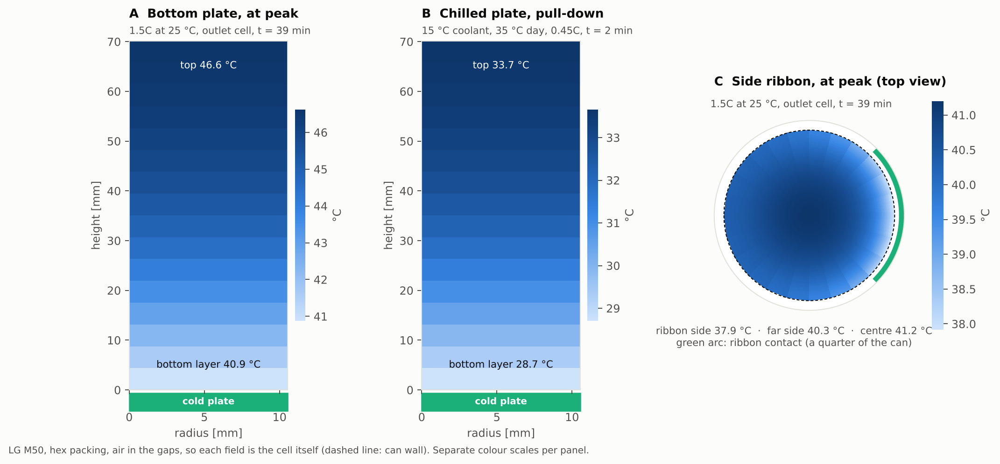
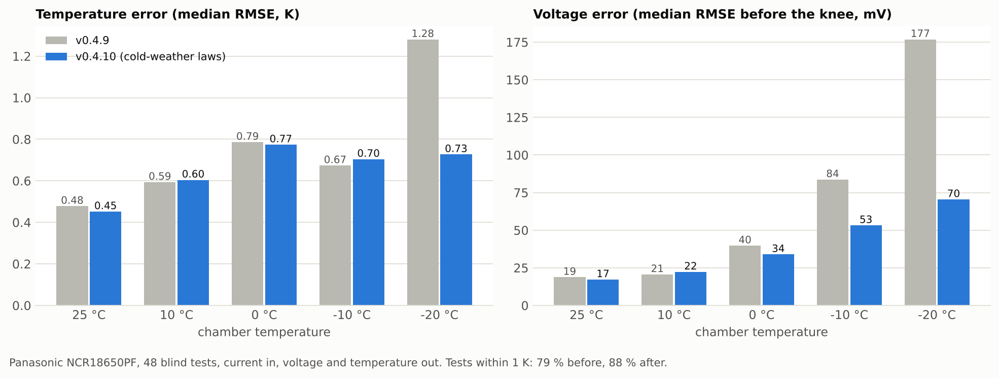
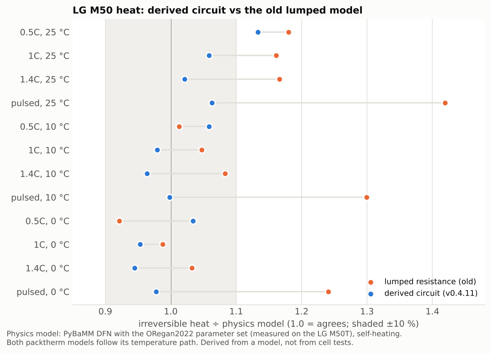

# PackTherm: battery thermal management design toolkit

PackTherm designs the cooling for a pack of cylindrical cells. Give it a cell, a duty cycle and your limits. It simulates every combination of cooling layout, coolant flow, chiller and gap filler (none, phase-change material or graphite composite) inside a packed module. Then it shows the trade-off between **mass added** and **fan, pump and chiller energy**, and picks the lightest, the most efficient and a balanced design that still pass when the cells' resistance is at its worst case.

It answers questions like *"for this cell and this duty, should I use air, a cold plate or a side ribbon, at what flow, and is PCM worth its weight?"* The cell model is validated against 48 blind tests on a commercial cell from 25 °C down to −20 °C. PackTherm started as an MSc thesis model in MATLAB; how it got here is in [docs/HISTORY.md](docs/HISTORY.md).


## Design result: LG M50 pack on a hot road trip

```bash
packtherm design M50 --duty roadtrip --t-env 35 --out-dir results/
```

An LG M50 21700 pack (61 kWh, 96s35p) in a C-segment EV drives at 130 km/h from 90 % to 10 % charge on a 35 °C day, then rapid-charges at 0.7C to 80 %. Limits: peak 45 °C, 5 K inside the cell, ready again (back near ambient, PCM re-frozen) within 3 hours. **39 designs, 23 feasible** ([CSV](docs/examples/module_m50_roadtrip_130kmh_35c_designs.csv)):

| Pick | Design | Hottest cell | Mass added | Fan, pump and chiller energy |
|---|---|---|---|---|
| Lightest | forced air, 0.15 g/s per cell | 39.5 °C | +1.8 % | 0.29 % of the energy moved |
| Lowest energy | bottom cold plate, 0.02 g/s per cell | 40.4 °C | +8.2 % | 0.05 % |
| Balanced | side ribbon, 0.02 g/s per cell, 3.5 mm gap | 39.2 °C | +7.2 % | 0.05 % |


**What it shows**
- **Liquid cooling costs very little to run.** About 0.05 % of the energy moved, mostly the radiator fan (the pump itself is under a fifth), against 0.29 % for the lightest air design. The real choice is hardware mass against fan energy.
- **A PCM that melts below ambient is a liability.** At 35 °C, RT31 (melting at 31 °C) never re-freezes, so every RT31 design without a chiller fails on recovery. RT42 still works.
- **A chiller holds every cell at 35 °C** but costs 1.2–2.1 % of the energy moved, 20–40 times the cheapest liquid design without one. Its COP falls with ambient (about 3.0 at 35 °C), and heat leaking in from the hot day is charged to it.
- **An uncooled pack reaches 55 °C.** Inside a pack, an interior cell has nowhere to shed heat, so "natural cooling" does not exist.

The same study on three back-to-back WLTC cycles ([chart](docs/examples/module_m50_wltc3_35c_tradeoff.png)) keeps every cooled design within 0.4 K of the 35 °C ambient, and even a sealed pack peaks at 36 °C: a 61 kWh pack sees mild C-rates on urban driving. **Thermal design is driven by motorway driving and rapid charging.**

### Inside the cell: why the 2D models matter

A cold plate under the cell or a ribbon on one side cools the cell unevenly, so those designs are solved on 2D slices of the cell's share ([how](docs/figures/model_overview.svg)). At 1.5C the plate-cooled cell runs about 6 K hotter at the top than at the base. The same plate pulling a hot-soaked pack down to a 15 °C chiller opens a large gradient while it does so, which is why some chilled plate designs fail on unevenness.



### Cooling layouts compared

```bash
packtherm module M50 --compare --c-rate 1.5
```

LG M50 at a 1.5C full discharge, 25 °C, hex packing, 0.05 g/s coolant per cell ([CSV](docs/examples/m50_module_1.5c_25c.csv)); the inlet cell is the first on the coolant channel and the outlet cell the last:

| Cooling | Filler | Inlet cell peak | Outlet cell peak | Cell-to-cell | Inside the cell | Pump / fan per cell |
|---|---|---|---|---|---|---|
| none | air | 68.5 °C | 68.5 °C | 0 K | 0 K | 0 |
| forced air, 2 mm gap | air | 41.0 °C | 44.2 °C | 3.2 K | 1.5 K | 169 mW |
| bottom plate | air | 41.5 °C | 46.6 °C | 5.1 K | **6.1 K** | 7.9 mW |
| bottom plate | RT42-EG | 39.4 °C | 41.8 °C | 2.4 K | 5.4 K | 7.9 mW |
| side ribbon, 3.5 mm gap | air | **33.0 °C** | 41.1 °C | 8.1 K | 3.4 K | 7.9 mW |
| side ribbon, 3.5 mm gap | RT31 | 32.3 °C | **36.1 °C** | 3.7 K | 3.5 K | 7.9 mW |

- **Side ribbon vs bottom plate for a 70 mm cell:** the ribbon runs about 8 K cooler at the inlet while touching a quarter of the can, and its in-cell spread is 3.4 K against 6.1 K. Pulling heat down the full height of the winding is slow, which is why tall cylindrical cells are usually side-cooled.
- **The coolant warms up to 11 K along the channel** at this flow, so the outlet cell runs up to 8 K hotter than the inlet cell. PCM in the gaps more than halves that spread (8.1 → 3.7 K).
- **More flow buys little:** the channels are laminar, so extra flow barely improves heat transfer at the can; it mostly cuts how much the coolant warms. On the road trip, tripling the flow lowers the hottest cell by 0.8–1.0 K for 20 times the pump power.

## Validation

**Measured cell (Panasonic NCR18650PF):** 48 blind tests (drive cycles, 1C discharge, CC-CV charge) at chamber temperatures from 25 °C to −20 °C, from the open Kollmeyer dataset (CC BY 4.0). One parameter, the chamber's heat-transfer coefficient, is calibrated on one further test.
- **Fully predictive** (current in, voltage and temperature out): median surface-temperature error **0.65 K RMSE**, with 88 % of tests within 1 K. Voltage error is 17–34 mV from 25 °C to 0 °C and 53–70 mV at −10 and −20 °C.
- **Thermal model alone** (measured heat in): **0.60 K** median, 96 % within 1 K, including 20 K self-heating rises at −20 °C.



**LG M50 (the design cell):** no open temperature data for it is reachable, so its equivalent circuit is **derived** from a physics model (PyBaMM DFN with the ORegan2022 parameter set, measured on the LG M50T). Its heat matches that model within −6 % to +13 % on discharges and pulsed loads at 25, 10 and 0 °C, where the earlier lumped model was up to 42 % high.



Method, per-test results and known gaps: [docs/VALIDATION.md](docs/VALIDATION.md). `tests/test_validation.py` guards these numbers in CI.

## What the model covers

- **Cells:** electro-thermal heat from current (equivalent circuit with Butler–Volmer kinetics and a slow branch, temperature- and SOC-dependent, with entropic heat where the cell has data), coulomb-counted SOC, voltage cut-off and CC-CV charging. Library: Panasonic NCR18650PF (measured), LG M50 (derived), LG MJ1 (lumped resistance); `packtherm cells` lists them.
- **Module:** one cell's share of a hex or square array. Gap filler: air, PCM (RT31, RT42 and others) or PCM + expanded graphite. Cooling: forced air through the gaps, a bottom cold plate (2D, radius × height) or a side ribbon (2D, radius × angle). The coolant warms along the channel with its own thermal mass. Every design is judged on four cells: interior and on the module wall, at the coolant inlet and outlet.
- **Energy:** fan and pump power from flow and pressure drop over the whole loop (laminar coolant channels, cross-flow air over the cans), the radiator fan, and chiller electricity with an ambient-dependent COP and heat leak.
- **Mass:** filler plus cooling hardware built up from sourced dimensions (plate sheets and channels, ribbon walls and ribs, bond lines, pack-level loop, fans and chiller).
- **Duties:** constant C-rate, a road trip (motorway then rapid charge), WLTC Class 3b through a road-load model, or a current CSV.
- **Picks:** the trade-off front of feasible designs, re-checked at worst-case resistance (the published maximum plus a 20 % ageing margin), with designs that fail reported and dropped.

**Limits to keep in mind:** the M50 circuit is derived, not measured; the plate and ribbon are 2D slices of a 3D field; flows, pressure drops, the roll-end resistance, wall U-value and pack-level masses are labelled assumptions. The full list, ranked by how much each could change a recommendation, is in [docs/BACKLOG.md](docs/BACKLOG.md).

## Quick start

```bash
pip install -e ".[dev]"
packtherm cells                                             # the cell library
packtherm design M50 --duty roadtrip --t-env 35 --out-dir results/
packtherm design M50 --duty roadtrip --t-env 35 --fast     # about 5x quicker, for exploring
packtherm design M50 --c-rate 1.5 --topologies air ribbon --coolant-flows 0.03 0.05 0.08 --gaps 1.5 2 3
packtherm module M50 --cooling ribbon --filler RT31-EG --flow 0.08 --inlet-c 20
packtherm module M50 --compare --duty roadtrip --t-env 35 --edge   # cells on the module wall
pytest -q
```

```python
from packtherm import LG_M50, Coolant, Layout, Module, SideRibbon, compare_modules
from packtherm.ev import road_trip_duty

duty = road_trip_duty(LG_M50)
module = Module(Layout("hex", 3.5), "RT42", SideRibbon(coolant=Coolant(flow_g_s_per_cell=0.02)))
(row,) = compare_modules(LG_M50, [module], duty, T_ambient_C=35)
print(f"outlet cell {row['T_peak_outlet_C']:.1f} °C, cell-to-cell {row['cell_to_cell_K']:.1f} K")
```

A module study of about 40 designs takes 2–3 minutes on two cores, or under a minute with `--fast` (peaks within about 0.1 K of normal mode; see [docs/FAST_MODE.md](docs/FAST_MODE.md)). `packtherm design --help` lists every design variable and limit.

## Roadmap

| Version | Scope |
|---|---|
| **v0.1** | Python port of the MATLAB thesis solver, parity tests, CI |
| **v0.2** | Electro-thermal heat generation, cell library (M50 21700, MJ1 18650), enthalpy-Newton solver, datasheet limit checks |
| **v0.3** | Design advisor: cooling × PCM sweep, feasibility (peak, ΔT, recovery), Pareto front, three picks, worst-case-resistance re-check, trade-off chart |
| **v0.3.1** | Continuous h with fan-law power, chiller, PCM grade library, WLTC and road-trip EV duties, iterative robustness, 2.6× faster solver |
| **v0.3.2** | Validation against measured temperatures (48 blind tests, 25 to −20 °C); equivalent-circuit electrical model with Butler–Volmer kinetics, voltage cut-off and CC-CV charging; validated Panasonic NCR18650PF cell |
| **v0.4** | Module level: packed unit cell (hex/square), air / PCM / composite-PCM filler, forced air, bottom plate, side ribbon, coolant rise with inlet/outlet cells, pump and fan power from flow |
| **v0.4.1** | Design advisor on the module model: flow, topology, filler and gap as design variables with physical pump/fan energy |
| **v0.4.2** | Rename to PackTherm, new model picture, housekeeping |
| **v0.4.3** | Cooling hardware mass from sourced geometry; ribbon gap and height coverage |
| **v0.4.4** | Chiller accounting: ambient-dependent COP, heat leak, chiller during the event only |
| **v0.4.5** | Whole-loop pump power and radiator fan energy |
| **v0.4.6** | Edge cells on the module wall, in the model and the advisor |
| **v0.4.7** | Coolant thermal mass in the channel |
| **v0.4.8** | 2D (radius × height) bottom-plate model |
| **v0.4.9** | Side ribbon on a strip of the can (radius × angle model) |
| **v0.4.10** | Cold-weather cell model: temperature laws for the low-SOC rise and slow branch (88 % of blind tests within 1 K) |
| **v0.4.11** | LG M50 equivalent circuit derived from a physics model (PyBaMM + ORegan2022); worst-case checks scale every loss term |
| **v0.4.12** | Audit: crash and message fixes, air cooling depends on the gap, rebuilt README, 2D field and validation figures |
| **v0.4.13** | Physics audit: laminar coolant channels and cross-flow air laws, in-cell spread measured on the cooled face, datasheet limits checked per phase and as currents, CLI input checks |
| **v0.5.0** (current) | Fast and normal modes: fast is about 5× quicker with the same verdicts on the example studies; exact region volumes on every mesh |
| v0.5.x (next) | Study file format, HTTP API, web app, public deployment |

Results from earlier versions, as they stood at the time, are in [docs/HISTORY.md](docs/HISTORY.md); every change is in [CHANGELOG.md](CHANGELOG.md).

## Repository layout

```
src/packtherm/        the package: cells, ecm, electrothermal, model (1D), model2d, module, hardware,
                      module_design, design, ev, materials, report, validation, cli
src/packtherm/data/   WLTC Class 3b trace (UN GTR 15), NCR18650PF and LG M50 OCV tables
validation/           dataset preparation, identification, M50 derivation and checks, processed test data
docs/examples/        design studies and module comparisons (charts and CSVs)
docs/figures/         model picture and 2D fields, with the scripts that draw them
docs/validation/      validation figures and per-test results
docs/VALIDATION.md    validation method and results
docs/BACKLOG.md       known issues and improvement plan
docs/FAST_MODE.md     fast and normal modes: settings, speed and accuracy
docs/HISTORY.md       earlier versions, thesis results and figures (docs/history/)
tests/                parity, physics, module, design and validation tests
matlab/               original thesis code and reference results
```
