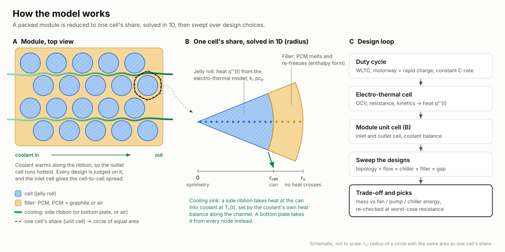
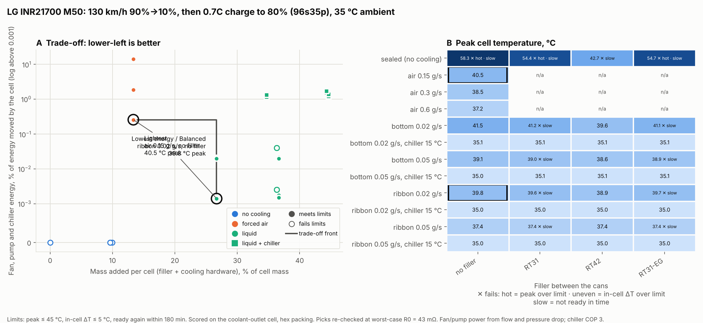
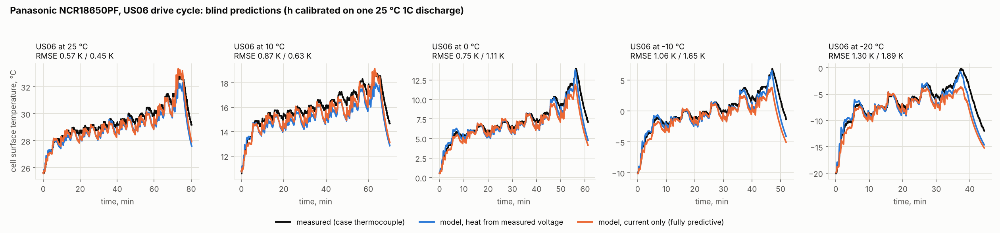
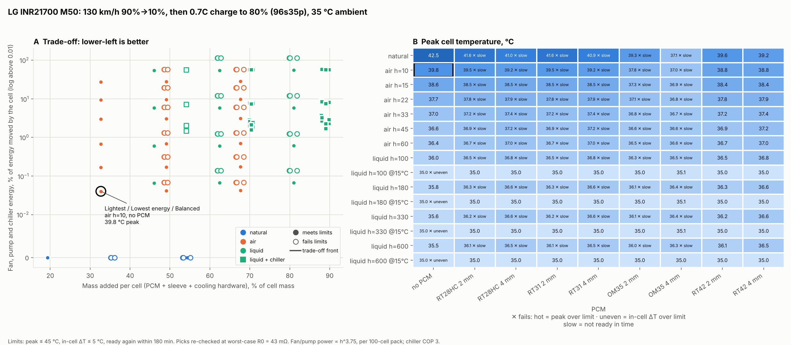

# PackTherm: battery thermal management design toolkit

A battery thermal management (BTMS) design tool for cylindrical-cell EV packs. It models a cell inside a packed module (electro-thermal heat, radial conduction, phase-change filler, coolant warming along the channel), sweeps cooling designs, and finds the trade-off between added mass and fan, pump and chiller energy. It started as an MSc thesis model in MATLAB and is now a validated Python package. The tool answers questions like *"for this cell and duty cycle, which cooling layout, how much flow, and is PCM worth its weight?"*



## Module design advisor (v0.4.1)

`packtherm design` now sweeps **module** designs by default: cooling topology (sealed, forced air, bottom plate, side ribbon) × flow per cell × chiller inlet × gap filler (none, PCM, composite PCM) × can-to-can gap. Each design is scored on its **hottest cell**: the interior cell at the coolant outlet, or since v0.4.6 a cell on the module wall (edge cell) if that runs hotter. The inlet and edge cells give the hottest-to-coolest spread, which can be limited (`--cell-to-cell-max`).

- **Energy is physical now.** Fan and pump power come from flow and pressure drop, plus chiller electricity (heat taken by sub-ambient coolant ÷ COP). Since v0.4.5 the pump covers the whole loop (module 20 kPa + rest of loop 30 kPa, efficiency 0.3, from Pierburg and Rheinmetall pump data) and the radiator fan is charged at 3 % of the heat it rejects.
- **Mass** = filler + cooling hardware built up from geometry (v0.4.3, below). The gap's volume cost is reported as `volume_overhead_pct`.
- Front, worst-case-resistance re-check and picks are shared with the single-cell advisor, which stays available as `--level cell`.

```bash
packtherm design M50 --duty roadtrip --t-env 35 --out-dir results/
packtherm design M50 --c-rate 1.5 --topologies air ribbon --coolant-flows 0.03 0.05 0.08 --gaps 1.5 2 3
packtherm design M50 --level cell --c-rate 1.5          # v0.3 isolated-cell advisor
```

**LG M50, 35 °C road trip** (130 km/h 90→10 %, then 0.7C charge to 80 %; [chart](docs/examples/module_m50_roadtrip_130kmh_35c_tradeoff.png), [CSV](docs/examples/module_m50_roadtrip_130kmh_35c_designs.csv)): 39 designs, 27 feasible.

| Pick | Design | Outlet-cell peak | Mass added | Aux energy |
|---|---|---|---|---|
| Lightest | forced air 0.15 g/s per cell | 40.5 °C | +1.8 % | 0.26 % |
| Lowest energy | bottom plate 0.02 g/s per cell | 41.5 °C | +8.2 % | 0.054 % |
| Balanced | side ribbon 0.02 g/s per cell, 3.5 mm gap | 39.9 °C | +7.2 % | 0.055 % |

**What it shows**
- **Once pump energy is physical, liquid cooling costs very little to run** (about 0.05 % of the energy moved, half pump and half radiator fan, against 0.26 % for the lightest air design). The trade-off is hardware mass against fan energy, so v0.4.3 builds the mass up from real dimensions.
- **A PCM that melts below ambient is a liability.** At 35 °C, RT31 never re-solidifies and every RT31 design fails on recovery; RT42 still works.
- **A chiller holds every cell at 35 °C** but costs 1.2–2.1 % of the energy moved, a thousand times the pump. Since v0.4.4 that includes heat leaking in from the hot day and a COP that falls with ambient (about 3.0 at 35 °C, 2.4 at 45 °C); the chiller runs during the drive and hands back to the radiator afterwards.



### Cooling hardware from geometry (v0.4.3)

Mass is built up from the parts, with every dimension a labelled, overridable default (`packtherm.module.PlateGeometry`, `RibbonGeometry`, `Interface`, `packtherm.hardware.PackHardware`):

| Part | Default | Source |
|---|---|---|
| Cold plate | 1.5 mm base + 1.0 mm channel sheet, 4 mm channels over half the footprint | brazed plates: base 1.5–2.0 mm, channel sheet 0.8–1.2 mm (AMAG); channels 4–8 mm (Boyd) |
| Side ribbon | 2.5 mm thick, 0.4 mm walls, 0.35 mm ribs every 2.5 mm, 75 % of the can height, one ribbon per two rows | 18650 ribbons: 2.2–3.2 mm thick, 48–50 mm tall, walls 0.25–0.8 mm, ribs 0.28–0.43 mm (XD Thermal) |
| Gap filler / bond | 0.5 mm, 2 W/m·K, 2.0 g/cm³ | low-density 2 W/m·K EV gap fillers are 1.95–2.0 g/cm³ (Dow TC-5515 LT and others); 1.8–2.2 more widely (Bostik) |
| Per pack | liquid loop 3 kg, air system 4 kg, chiller 4 kg | assumptions; compressor and radiator are shared with the car and not charged |

For an M50 module this gives about **0.3 kg/kWh** for liquid cooling (cold plate 5.6 g per cell, ribbon 4.9 g) and **0.07 kg/kWh** for air, against the earlier flat 1.0 and 0.5. Whole cooling systems are quoted at 0.5–5 kg/kWh because they include the radiator, compressor and structure.

Two consequences for the thermal model:
- **The ribbon needs room.** The tube plus a bond on each side sets the minimum gap (3.5 mm by default); the advisor and `packtherm module` widen the gap to fit, and the tube's volume holds no filler.
- **The ribbon covers 75 % of the can height**, so its contact conductance is now scaled by that share (it used to assume full height).

## Module level (v0.4)

Real cells sit in a packed array, so the free-air single-cell picture no longer applies. `packtherm module` models one cell in its share of a **square or hexagonal array**. By symmetry nothing crosses into the neighbour's share, so the unit cell's outer edge is adiabatic.

- **Gap filler:**
  - air;
  - plain PCM;
  - **composite PCM** (paraffin + expanded graphite: 3.85 W/m·K, latent heat × 0.86; grades `RT31-EG` etc.).
- **Cooling topologies:**
  - **forced air** through the gaps;
  - a **bottom cold plate**: heat runs down the winding (k_axial = 25 W/m·K, computed from the layer stack), across the roll-end resistance and the thermal interface (bond line / k) into the coolant;
  - a **side ribbon** bonded to part of each can;
  - none (an interior cell of an uncooled pack is adiabatic).
- **Coolant (or air) warms along the channel**, in balance with the heat it absorbs. The model reports the **coolest (inlet) and hottest (outlet) cell** and the spread between them.
- **Flow is the single cooling variable.** It sets h (h ∝ flow^0.8) and the coolant rise; pump or fan power is (flow/ρ)·Δp/η with Δp ∝ flow².

```bash
packtherm module M50 --compare --c-rate 1.5
packtherm module M50 --compare --duty roadtrip --t-env 35
packtherm module M50 --cooling ribbon --filler RT31-EG --flow 0.08 --inlet-c 20
```

**LG M50 at 1.5C full discharge, 25 °C** (hex packing, 2 mm gaps, 0.05 g/s coolant per cell; [CSV](docs/examples/m50_module_1.5c_25c.csv)):

| Cooling | Filler | Inlet cell peak | Outlet cell peak | Cell-to-cell | In-cell ΔT | Pump / fan per cell |
|---|---|---|---|---|---|---|
| none | air | 72.2 °C | 72.2 °C | 0 K | 0 K | 0 |
| forced air | air | 40.6 °C | 44.1 °C | 3.6 K | 1.5 K | 169 mW |
| bottom plate | air | 41.0 °C | 46.7 °C | 5.7 K | **5.9 K** | 7.9 mW |
| bottom plate | RT42-EG | 39.0 °C | 41.7 °C | 2.8 K | 5.2 K | 7.9 mW |
| side ribbon (3.5 mm gap) | air | **32.1 °C** | 40.8 °C | 8.7 K | 3.2 K | 7.9 mW |
| side ribbon (3.5 mm gap) | RT31 | 31.6 °C | **35.9 °C** | 4.3 K | 3.0 K | 7.9 mW |

**What it shows**
- **Natural cooling doesn't exist inside a pack.** An uncooled interior cell reaches 72 °C, where the free-air single-cell model said about 41 °C.
- **Side ribbon vs bottom plate for a 70 mm cell:** the ribbon wins by about 9 K at the inlet even on a quarter of the circumference and 75 % of the height, and its in-cell ΔT is 3.2 K against 5.9 K (2D radius × height model since v0.4.8). Pulling heat down the full height of the winding is slow, which is why tall cylindrical cells are usually side-cooled.
- **The coolant warms 9–11 K along the channel at this flow**, so the outlet cell runs up to 10 K hotter. PCM in the gaps cuts that spread by half (8.7 → 4.3 K).
- **On the 35 °C road trip** (0.45C driving, then 0.7C charge), every liquid topology keeps the M50 within 39 °C, but an uncooled pack reaches 58 °C. Tripling the coolant flow buys about 1.3 K for 27× the pump power.

**Limits of the module model:**
- Bottom plates are solved on a radius × height grid (v0.4.8) and side ribbons on a radius × angle grid (v0.4.9), each a 2D slice of a 3D field.
- Coolant thermal mass (v0.4.7) is lumped per cell's share of the channel (about 20 s lag at the reference flow). Edge cells (v0.4.6) see the wall through a single assumed U-value.
- Flow, Δp, h_ref, the thermal interface, the roll-end resistance and the hardware dimensions are labelled assumptions in `module.py` and `hardware.py`.

## Validated against measured temperatures (v0.3.2)

The thermal model has been tested blind against **49 tests on a commercial Panasonic NCR18650PF cell**, the cell the thesis calibrated against. The tests cover drive cycles, 1C discharge and CC-CV charge at chamber temperatures from 25 °C down to −20 °C, from the open Kollmeyer dataset (CC BY 4.0).
- **One parameter calibrated:** the chamber h, on one test.
- **Thermal model:** median surface-temperature error **0.59 K RMSE**; 96 % of tests within 1 K, including 20 K self-heating rises at −20 °C.
- **Fully predictive** (current in, voltage and temperature out):
  - temperature: **0.62 K** median RMSE;
  - voltage: **19–40 mV** median from 25 °C to 0 °C;
  - CC-CV taper reproduced within 0.19 A.



Method, per-test results and known gaps are in [docs/VALIDATION.md](docs/VALIDATION.md). Reproduce with `python validation/run_panasonic.py`; `tests/test_validation.py` guards the claims in CI.

## Status: v0.3.1, passenger-EV design advisor

Give the advisor a cell, a duty cycle and your limits. It simulates every combination of cooling and PCM choice, then shows the trade-off between **mass added** and **cooling energy** (fans, pumps and chiller):

```bash
packtherm design M50 --duty roadtrip --t-env 35 --out-dir results/   # 130 km/h motorway, then rapid charge, on a 35 °C day
packtherm design M50 --duty wltc --cycles 3 --t-env 35               # three back-to-back WLTC cycles
packtherm design M50 --c-rate 1.5                                    # constant-current duty
```



```
LG INR21700 M50, 130 km/h 90%→10%, then 0.7C charge to 80% (96s35p), ambient 35 degC
Limits: T_peak <= 45 degC, in-cell dT <= 5 degC, ready again within 180 min
135 designs, 65 feasible, 1 on the trade-off front
Lightest       air h=10, no PCM: T_peak 40.5 degC, +32.7% mass, aux 0.04% of energy, recovery 39 min
Not picked     natural, no PCM: +19.3% mass, aux 0.00%, but fails (hot) at worst-case R0 = 43 mOhm (peak 46.6 degC)
Not picked     natural, RT42 2 mm: +35.7% mass, aux 0.00%, but fails (slow) at worst-case R0 = 43 mOhm (peak 41.4 degC)
```

**Design space (v0.3.1)**
- **Cooling:**
  - natural convection;
  - forced air at h = 10–60 W/m²K;
  - liquid at h = 100–600, either at ambient (radiator) or **chilled** to 15 °C.
  - Fan/pump power follows the **fan law P ∝ h^3.75**, from h ∝ v^0.8 (Dittus–Boelter) and P ∝ v³. It is anchored to the thesis mid levels.
  - Chiller electricity = heat removed ÷ COP (default 3.0; vapour-compression chillers typically achieve 2.4–3.5).
- **PCM:** none, or **RT28HC, RT31, OM35 or RT42** (melting 27–43 °C, sourced in `materials.py`) at 2 or 4 mm.
- **Passenger-EV duties** (`packtherm.ev`):
  - the **WLTC Class 3b** speed trace (UN GTR 15), driven through a road-load model of a C-segment EV (146 Wh/km on WLTC) and a 61 kWh 96s35p pack of M50 cells;
  - a **road trip**: 130 km/h from 90 % to 10 %, then rapid charge at the cell's rated C-rate to 80 %.

**How a design is judged**
- **Feasible:**
  - the peak cell temperature stays within the limit (default min(45 °C, datasheet));
  - the in-cell spread stays within 5 °C;
  - the cell is **ready again** within the rest window: within 1 K of ambient, PCM re-solidified.
- **Costs:**
  - mass added: PCM, sleeve and cooling hardware, as % of cell mass;
  - cooling energy as % of the energy the cell moves, with fans, pumps and the chiller running **until the cell is ready again**.
- **Front and picks:** the front is the set of feasible designs that no other feasible design beats on both costs. Three picks come from it: lightest, lowest energy, and balanced.
- **Robustness:**
  - front designs are re-run at **worst-case resistance**: the published maximum plus a 20 % margin for ageing;
  - designs that fail are reported as *Not picked*, with the reason, and the front is rebuilt without them;
  - C-rates above the datasheet continuous rating (judged on a 30 s rolling mean) are flagged.

**What the M50 studies show**
- **Hot-day road trip (35 °C):**
  - mild forced air (h = 10) is enough, with a peak of 40.5 °C;
  - natural cooling with RT42 PCM keeps the peak lower but fails at worst-case resistance on recovery time;
  - every PCM that melts at or below ambient can never re-solidify without a chiller, so the **melt temperature has to sit above the hottest ambient**.
- **1.5C discharge at 25 °C** ([chart](docs/examples/m50_discharge_1.5c_25c_tradeoff.png)):
  - low-h liquid cooling is the lowest-energy option, because the fan law makes gentle flow almost free;
  - air at h = 22 would be lighter but overheats at worst-case resistance (46.3 °C).
- **Chilled coolant at high h** fails on in-cell spread: pulling a 25 °C cell down to 15 °C quickly creates a gradient above 5 °C.
- **WLTC at 35 °C** ([chart](docs/examples/m50_wltc3_35c_tradeoff.png)): a 60 kWh pack sees mild C-rates (mean 0.11C, peak 0.9C), so thermal design is driven by **rapid charging and motorway driving, not urban cycles**.

**Biggest caveat:** each cell is modelled on its own with a uniform h around it. That makes natural and liquid cooling optimistic, and the per-cell PCM sleeve heavy. Module-level geometry is next (v0.4); see [docs/BACKLOG.md](docs/BACKLOG.md) for every known limitation and the improvement plan.

**Assumptions to know (all adjustable via CLI flags)**
- **Cooling hardware mass:** 0.5 kg/kWh for air, 1.0 for liquid, plus 0.3 for a chiller (industry range 0.5–5 kg/kWh).
- **Fan law:** anchors at the thesis mid-level powers per 100 cells.
- **Vehicle:** C-segment EV parameters in `ev.Vehicle`.
- **Casing:** a 1 mm aluminium sleeve per cell.
- **Time step:** sweeps use dt = 2 s (within 0.01 °C of 0.5 s).

## v0.2: electro-thermal cells

**New in v0.2**
- **Heat generation from real cells.** Heat comes from current via Q = I²R(SOC, T) − I·T·dU/dT(SOC), with coulomb-counted SOC and temperature feeding back into resistance every step.
- **Cell library** with every value sourced (see `src/packtherm/cells.py`):
  - **LG M50 21700:** 5 Ah, NMC811/graphite-SiOx, fully characterised by Chen 2020 and O'Regan 2022.
  - **LG MJ1 18650:** 3.5 Ah, same chemistry family.
  - Jelly-roll heat capacity and radial conductivity are computed from O'Regan's measured layer properties. Entropic coefficients are the paper's electrode fits mapped to cell SOC.
- **Duty cycles:** constant C-rate, piecewise segments (repeatable drive cycles), or a CSV of current against time. Charge windows such as 10→80 % are respected.
- **Datasheet checks:** warnings when the C-rate or peak temperature breaks the cell's rated limits.
- **Faster, exactly conservative solver.** Newton iteration on the enthalpy residual replaces the thesis Picard scheme. It converges on every step in about 2 iterations (the old scheme stalled on 5–19 steps per run), runs about 3× faster, and closes the energy balance to round-off. The thesis scheme is kept as `SolverSettings(scheme="thesis")` and still reproduces the MATLAB results exactly.

```bash
packtherm cells
packtherm cell M50 --mode discharge --c-rate 1.5 --cooling liquid --level mid --pcm-mm 3
packtherm cell M50 --mode charge --c-rate 0.7 --soc0 0.1 --soc-max 0.8 --cooling air --level low --pcm-mm 0
```

**First design finding: PCM can make things worse.** For an LG M50 at 2.5C discharge (peak cell temperature):

| Cooling | No PCM | 3 mm PCM |
|---|---|---|
| Air, h = 10 W/m²K | 65.2 °C | **53.4 °C** (PCM buffers the heat) |
| Air, h = 60 | **44.4 °C** | 46.4 °C |
| Liquid, h = 300 | **35.2 °C** | 43.5 °C (paraffin insulates the cell from the coolant) |

PCM pays off only when the active cooling is weak. Finding the right thickness for a given cooling system is what the v0.3 design advisor will do.

## v0.1: Python port

The thesis solver has been ported to Python (`src/packtherm`) and reproduces the MATLAB results to about 1e-11 on every summary metric for the four thesis scenarios. It also reproduces the mesh and time-step studies. The original MATLAB code is kept in [`matlab/`](matlab/) as the reference.

| Scenario | Peak T (°C) | In-cell ΔT (°C) | Mean PCM liquid fraction | Fan/pump energy (Wh) | Energy-balance error |
|---|---|---|---|---|---|
| drive, air, mid (h=30) | 31.67 | 1.39 | 0.02 | 3.3 | 0.013 % |
| drive, liquid, low (h=100) | 31.09 | 1.43 | 0.005 | 1.7 | 0.0007 % |
| fast charge, air, high (h=60) | 36.81 | 2.07 | 0.32 | 40 | 0.003 % |
| fast charge, liquid, mid (h=300) | 33.56 | 2.09 | 0.07 | 40 | 0.001 % |

These results already contain a design insight: with liquid cooling the PCM barely melts (about 7 % used), so it adds mass with little benefit. With weaker air cooling the PCM does real work.

## Quick start

```bash
pip install -e ".[dev]"
packtherm                 # run the four thesis scenarios
pytest -q            # parity + physics tests
```

```python
from packtherm import default_params, simulate

P = default_params()
res = simulate(P, heat_source=lambda t: 9.4e4, duration=1800, h=60.0, T_env=P.T_coolant)
print(res.T_max.max() - 273.15, res.pcm_fraction.max(), res.balance_error_pct)
```

## Model

- **Domain:** a 1D radial line from the cell centre (18650 geometry, r = 9 mm) through 3 mm of RT31-type paraffin PCM to a 1 mm Al 6061 casing.
- **Discretisation:** conservative cell-centred finite volumes in cylindrical coordinates, harmonic-mean face conductivities, and backward Euler in time.
- **PCM:** apparent heat capacity over the 29–34 °C melting range, iterated per step with under-relaxed Picard iteration.
- **Boundary:** a convective outer wall, with half-cell conduction and 1/h in series.
- **Verification:** an independent enthalpy-based energy balance (< 0.1 % error required), plus mesh (Nx 65/130/260) and time-step (1 to 0.125 s) convergence studies.

**Model limits to keep in mind:**
- The model is a single cell with a uniform h around its whole circumference. In a real pack a cold plate touches only part of each cell, so liquid-cooling results are optimistic. Pack-level effects come in v0.4.
- Resistance is a lumped DCIR. Its temperature (Arrhenius, 20 kJ/mol) and SOC shapes are documented assumptions until measured HPPC maps are added.

## Roadmap

| Version | Scope |
|---|---|
| **v0.1** ✅ | Python port, parity tests, CI |
| **v0.2** ✅ | Electro-thermal heat generation, cell library (M50 21700, MJ1 18650), enthalpy-Newton solver, datasheet limit checks |
| **v0.3** ✅ | Design advisor: cooling × PCM sweep, feasibility (peak, ΔT, recovery), Pareto front, three picks, worst-case-resistance re-check, trade-off chart |
| **v0.3.1** ✅ | Continuous h with fan-law power, chiller, PCM grade library, WLTC and road-trip EV duties, iterative robustness, 2.6× faster solver |
| **v0.3.2** ✅ | Validation against 49 measured tests (25 to −20 °C); equivalent-circuit electrical model with Butler–Volmer kinetics, voltage cut-off and CC-CV charging; validated Panasonic NCR18650PF cell |
| **v0.4** ✅ | Module level: packed unit cell (hex/square), air / PCM / composite-PCM filler, forced air, bottom plate, side ribbon, coolant rise with inlet/outlet cells, pump and fan power from flow |
| **v0.4.1** ✅ | Design advisor on the module model: flow, topology, filler, gap as design variables with physical pump/fan energy |
| **v0.4.2** ✅ | Rename to PackTherm, new model picture, housekeeping |
| **v0.4.3** ✅ | Cooling hardware mass from sourced geometry; ribbon gap and height coverage |
| **v0.4.4** ✅ | Chiller accounting: ambient-dependent COP, heat leak, chiller during the event only |
| **v0.4.5** ✅ | Whole-loop pump power and radiator fan energy |
| **v0.4.6** ✅ | Edge cells on the module wall in the model and the advisor |
| **v0.4.7** ✅ | Coolant thermal mass in the channel |
| **v0.4.8** ✅ | 2D (radius × height) bottom-plate model |
| **v0.4.9** ✅ | Side ribbon on a strip of the can (radius × angle model) |
| **v0.4.10** ✅ | Cold-weather cell model: temperature laws for the low-SOC rise and slow branch (88 % of blind tests within 1 K) |
| v0.5 | Web app and API |

## Repository layout

```
src/packtherm/        Python package (params, model, cells, materials, ecm, electrothermal, module, module_design, hardware, ev, design, report, validation, scenarios, metrics, cli)
src/packtherm/data/   WLTC Class 3b speed trace (UN GTR 15), NCR18650PF OCV
validation/      dataset preparation, model identification and validation scripts + processed test data
docs/VALIDATION.md  validation method and results
docs/BACKLOG.md  known issues and improvement plan
docs/examples/   design-study charts and CSVs
tests/           MATLAB-parity and physics tests
matlab/          original thesis code + reference results
docs/figures/    thesis figures
```
