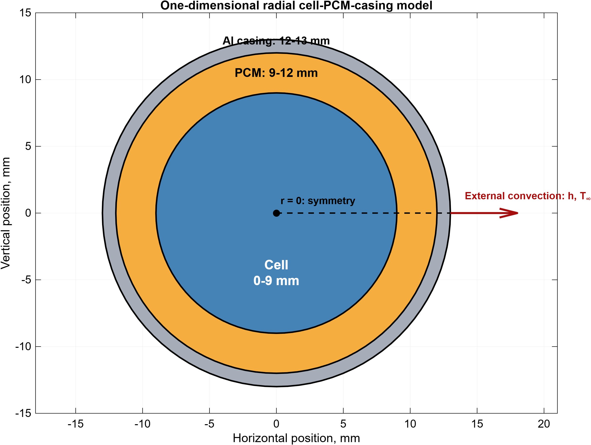

# EV_BTMS: battery thermal management design toolkit

A transient thermal model of a lithium-ion cell wrapped in a phase-change material (PCM) layer and an aluminium casing, cooled by forced air or a liquid cold plate. It started as an MSc thesis model in MATLAB and is being developed into a Python **BTMS design tool**. The tool answers questions like *"for this cell and duty cycle, do I need PCM, how much cooling, and what does it cost in fan or pump energy?"*



## Status: v0.3.1, passenger-EV design advisor

Give the advisor a cell, a duty cycle and your limits. It simulates every combination of cooling and PCM choice, then shows the trade-off between **mass added** and **cooling energy** (fans, pumps and chiller):

```bash
btms design M50 --duty roadtrip --t-env 35 --out-dir results/   # 130 km/h motorway, then rapid charge, on a 35 °C day
btms design M50 --duty wltc --cycles 3 --t-env 35               # three back-to-back WLTC cycles
btms design M50 --c-rate 1.5                                    # constant-current duty
```


```
LG INR21700 M50, 130 km/h 90%→10%, then 0.7C charge to 80% (96s35p), ambient 35 degC
Limits: T_peak <= 45 degC, in-cell dT <= 5 degC, ready again within 180 min
135 designs, 65 feasible, 1 on the trade-off front
Lightest       air h=10, no PCM: T_peak 40.5 degC, +32.7% mass, aux 0.04% of energy, recovery 39 min
Not picked     natural, no PCM: +19.3% mass, aux 0.00%, but fails (hot) at worst-case R0 = 43 mOhm (peak 46.6 degC)
Not picked     natural, RT42 2 mm: +35.7% mass, aux 0.00%, but fails (slow) at worst-case R0 = 43 mOhm (peak 41.4 degC)
```

**Design space (v0.3.1)**
- **Cooling:**
  - natural convection;
  - forced air at h = 10–60 W/m²K;
  - liquid at h = 100–600, either at ambient (radiator) or **chilled** to 15 °C.
  - Fan/pump power follows the **fan law P ∝ h^3.75**, from h ∝ v^0.8 (Dittus–Boelter) and P ∝ v³. It is anchored to the thesis mid levels.
  - Chiller electricity = heat removed ÷ COP (default 3.0; vapour-compression chillers typically achieve 2.4–3.5).
- **PCM:** none, or **RT28HC, RT31, OM35 or RT42** (melting 27–43 °C, sourced in `materials.py`) at 2 or 4 mm.
- **Passenger-EV duties** (`btms.ev`):
  - the **WLTC Class 3b** speed trace (UN GTR 15), driven through a road-load model of a C-segment EV (146 Wh/km on WLTC) and a 61 kWh 96s35p pack of M50 cells;
  - a **road trip**: 130 km/h from 90 % to 10 %, then rapid charge at the cell's rated C-rate to 80 %.

**How a design is judged**
- **Feasible:**
  - the peak cell temperature stays within the limit (default min(45 °C, datasheet));
  - the in-cell spread stays within 5 °C;
  - the cell is **ready again** within the rest window: within 1 K of ambient, PCM re-solidified.
- **Costs:**
  - mass added: PCM, sleeve and cooling hardware, as % of cell mass;
  - cooling energy as % of the energy the cell moves, with fans, pumps and the chiller running **until the cell is ready again**.
- **Front and picks:** the front is the set of feasible designs that no other feasible design beats on both costs. Three picks come from it: lightest, lowest energy, and balanced.
- **Robustness:**
  - front designs are re-run at **worst-case resistance**: the published maximum plus a 20 % margin for ageing;
  - designs that fail are reported as *Not picked*, with the reason, and the front is rebuilt without them;
  - C-rates above the datasheet continuous rating (judged on a 30 s rolling mean) are flagged.

**What the M50 studies show**
- **Hot-day road trip (35 °C):**
  - mild forced air (h = 10) is enough, with a peak of 40.5 °C;
  - natural cooling with RT42 PCM keeps the peak lower but fails at worst-case resistance on recovery time;
  - every PCM that melts at or below ambient can never re-solidify without a chiller, so the **melt temperature has to sit above the hottest ambient**.
- **1.5C discharge at 25 °C** ([chart](docs/examples/m50_discharge_1.5c_25c_tradeoff.png)):
  - low-h liquid cooling is the lowest-energy option, because the fan law makes gentle flow almost free;
  - air at h = 22 would be lighter but overheats at worst-case resistance (46.3 °C).
- **Chilled coolant at high h** fails on in-cell spread: pulling a 25 °C cell down to 15 °C quickly creates a gradient above 5 °C.
- **WLTC at 35 °C** ([chart](docs/examples/m50_wltc3_35c_tradeoff.png)): a 60 kWh pack sees mild C-rates (mean 0.11C, peak 0.9C), so thermal design is driven by **rapid charging and motorway driving, not urban cycles**.

**Biggest caveat:** each cell is modelled on its own with a uniform h around it. That makes natural and liquid cooling optimistic, and the per-cell PCM sleeve heavy. Module-level geometry is next (v0.4); see [docs/BACKLOG.md](docs/BACKLOG.md) for every known limitation and the improvement plan.

**Assumptions to know (all adjustable via CLI flags)**
- **Cooling hardware mass:** 0.5 kg/kWh for air, 1.0 for liquid, plus 0.3 for a chiller (industry range 0.5–5 kg/kWh).
- **Fan law:** anchors at the thesis mid-level powers per 100 cells.
- **Vehicle:** C-segment EV parameters in `ev.Vehicle`.
- **Casing:** a 1 mm aluminium sleeve per cell.
- **Time step:** sweeps use dt = 2 s (within 0.01 °C of 0.5 s).

## v0.2: electro-thermal cells

**New in v0.2**
- **Heat generation from real cells.** Heat comes from current via Q = I²R(SOC, T) − I·T·dU/dT(SOC), with coulomb-counted SOC and temperature feeding back into resistance every step.
- **Cell library** with every value sourced (see `src/btms/cells.py`):
  - **LG M50 21700:** 5 Ah, NMC811/graphite-SiOx, fully characterised by Chen 2020 and O'Regan 2022.
  - **LG MJ1 18650:** 3.5 Ah, same chemistry family.
  - Jelly-roll heat capacity and radial conductivity are computed from O'Regan's measured layer properties. Entropic coefficients are the paper's electrode fits mapped to cell SOC.
- **Duty cycles:** constant C-rate, piecewise segments (repeatable drive cycles), or a CSV of current against time. Charge windows such as 10→80 % are respected.
- **Datasheet checks:** warnings when the C-rate or peak temperature breaks the cell's rated limits.
- **Faster, exactly conservative solver.** Newton iteration on the enthalpy residual replaces the thesis Picard scheme. It converges on every step in about 2 iterations (the old scheme stalled on 5–19 steps per run), runs about 3× faster, and closes the energy balance to round-off. The thesis scheme is kept as `SolverSettings(scheme="thesis")` and still reproduces the MATLAB results exactly.

```bash
btms cells
btms cell M50 --mode discharge --c-rate 1.5 --cooling liquid --level mid --pcm-mm 3
btms cell M50 --mode charge --c-rate 0.7 --soc0 0.1 --soc-max 0.8 --cooling air --level low --pcm-mm 0
```

**First design finding: PCM can make things worse.** For an LG M50 at 2.5C discharge (peak cell temperature):

| Cooling | No PCM | 3 mm PCM |
|---|---|---|
| Air, h = 10 W/m²K | 65.2 °C | **53.4 °C** (PCM buffers the heat) |
| Air, h = 60 | **44.4 °C** | 46.4 °C |
| Liquid, h = 300 | **35.2 °C** | 43.5 °C (paraffin insulates the cell from the coolant) |

PCM pays off only when the active cooling is weak. Finding the right thickness for a given cooling system is what the v0.3 design advisor will do.

## v0.1: Python port

The thesis solver has been ported to Python (`src/btms`) and reproduces the MATLAB results to about 1e-11 on every summary metric for the four thesis scenarios. It also reproduces the mesh and time-step studies. The original MATLAB code is kept in [`matlab/`](matlab/) as the reference.

| Scenario | Peak T (°C) | In-cell ΔT (°C) | Mean PCM liquid fraction | Fan/pump energy (Wh) | Energy-balance error |
|---|---|---|---|---|---|
| drive, air, mid (h=30) | 31.67 | 1.39 | 0.02 | 3.3 | 0.013 % |
| drive, liquid, low (h=100) | 31.09 | 1.43 | 0.005 | 1.7 | 0.0007 % |
| fast charge, air, high (h=60) | 36.81 | 2.07 | 0.32 | 40 | 0.003 % |
| fast charge, liquid, mid (h=300) | 33.56 | 2.09 | 0.07 | 40 | 0.001 % |

These results already contain a design insight: with liquid cooling the PCM barely melts (about 7 % used), so it adds mass with little benefit. With weaker air cooling the PCM does real work.

## Quick start

```bash
pip install -e ".[dev]"
btms                 # run the four thesis scenarios
pytest -q            # parity + physics tests
```

```python
from btms import default_params, simulate

P = default_params()
res = simulate(P, heat_source=lambda t: 9.4e4, duration=1800, h=60.0, T_env=P.T_coolant)
print(res.T_max.max() - 273.15, res.pcm_fraction.max(), res.balance_error_pct)
```

## Model

- **Domain:** a 1D radial line from the cell centre (18650 geometry, r = 9 mm) through 3 mm of RT31-type paraffin PCM to a 1 mm Al 6061 casing.
- **Discretisation:** conservative cell-centred finite volumes in cylindrical coordinates, harmonic-mean face conductivities, and backward Euler in time.
- **PCM:** apparent heat capacity over the 29–34 °C melting range, iterated per step with under-relaxed Picard iteration.
- **Boundary:** a convective outer wall, with half-cell conduction and 1/h in series.
- **Verification:** an independent enthalpy-based energy balance (< 0.1 % error required), plus mesh (Nx 65/130/260) and time-step (1 to 0.125 s) convergence studies.

**Model limits to keep in mind:**
- The model is a single cell with a uniform h around its whole circumference. In a real pack a cold plate touches only part of each cell, so liquid-cooling results are optimistic. Pack-level effects come in v0.4.
- Resistance is a lumped DCIR. Its temperature (Arrhenius, 20 kJ/mol) and SOC shapes are documented assumptions until measured HPPC maps are added.

## Roadmap

| Version | Scope |
|---|---|
| **v0.1** ✅ | Python port, parity tests, CI |
| **v0.2** ✅ | Electro-thermal heat generation, cell library (M50 21700, MJ1 18650), enthalpy-Newton solver, datasheet limit checks |
| **v0.3** ✅ | Design advisor: cooling × PCM sweep, feasibility (peak, ΔT, recovery), Pareto front, three picks, worst-case-resistance re-check, trade-off chart |
| **v0.3.1** ✅ | Continuous h with fan-law power, chiller, PCM grade library, WLTC and road-trip EV duties, iterative robustness, 2.6× faster solver |
| v0.4 | Module level: packed unit cell, cold-plate contact and coolant temperature rise, composite PCM; validation against the open Warwick LG M50 dataset |
| v0.5 | Web app and API |

## Repository layout

```
src/btms/        Python package (params, model, cells, materials, electrothermal, ev, design, report, scenarios, metrics, cli)
src/btms/data/   WLTC Class 3b speed trace (UN GTR 15)
docs/BACKLOG.md  known issues and improvement plan
docs/examples/   design-study charts and CSVs
tests/           MATLAB-parity and physics tests
matlab/          original thesis code + reference results
docs/figures/    thesis figures
```
