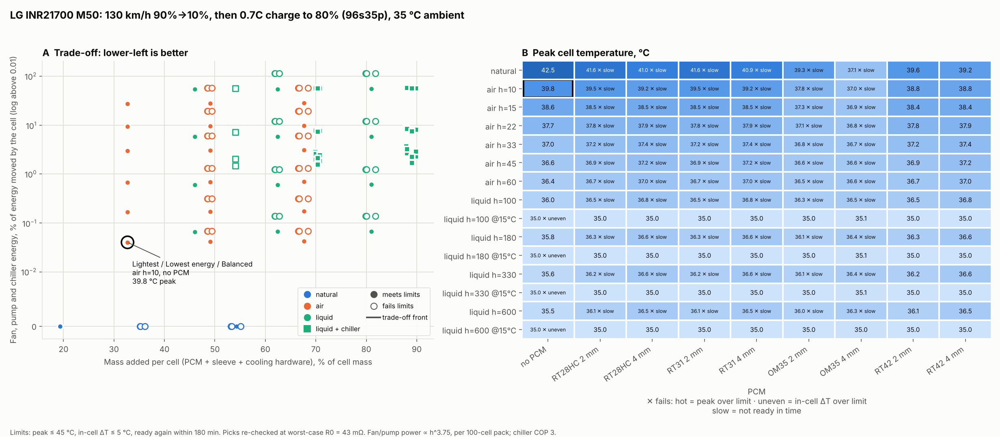
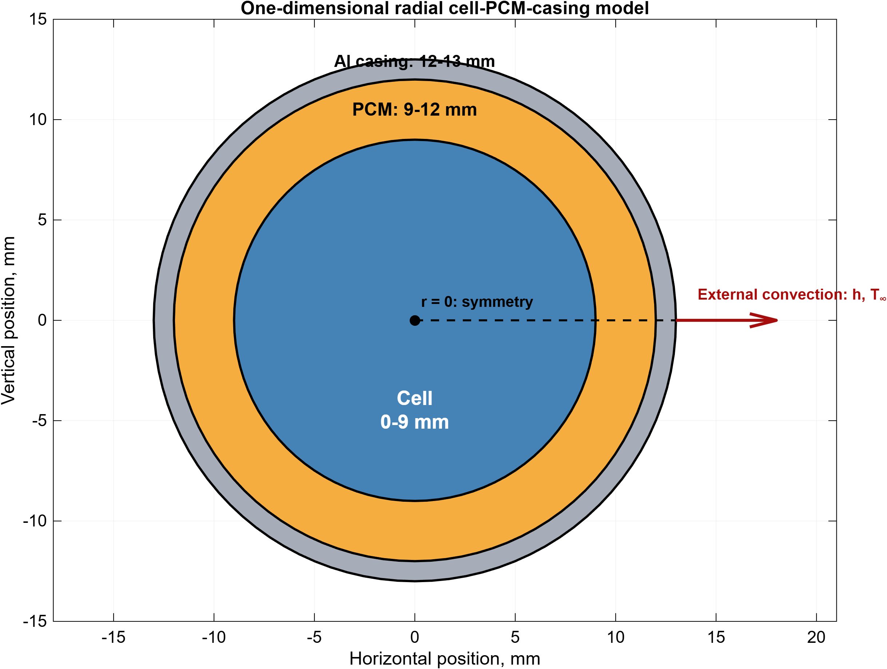
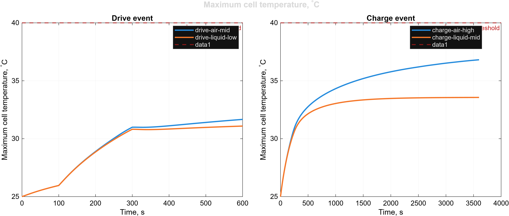
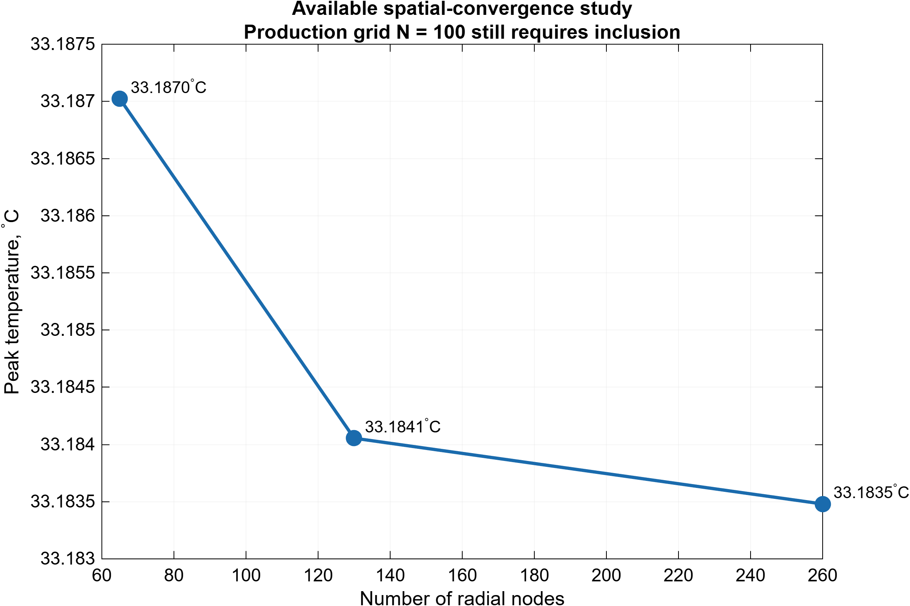
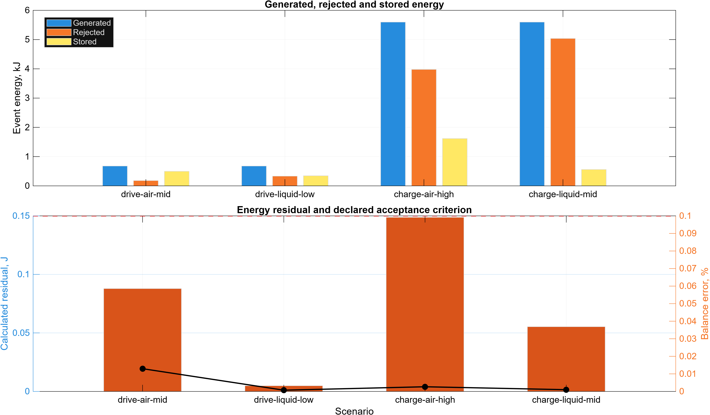

# History

How PackTherm grew from an MSc thesis model to a module design tool. Results on this page are **snapshots from the version named**: the model has changed since, so re-running the commands today gives different numbers. Current results are in the [README](../README.md); every change is in [CHANGELOG.md](../CHANGELOG.md).

## Versions

| Version | Scope |
|---|---|
| **v0.1** | Python port of the MATLAB thesis solver, parity tests, CI |
| **v0.2** | Electro-thermal heat generation, cell library (M50 21700, MJ1 18650), enthalpy-Newton solver, datasheet limit checks |
| **v0.3** | Design advisor: cooling × PCM sweep, feasibility (peak, ΔT, recovery), Pareto front, three picks, worst-case-resistance re-check, trade-off chart |
| **v0.3.1** | Continuous h with fan-law power, chiller, PCM grade library, WLTC and road-trip EV duties, iterative robustness, 2.6× faster solver |
| **v0.3.2** | Validation against measured temperatures (48 blind tests, 25 to −20 °C); equivalent-circuit electrical model with Butler–Volmer kinetics, voltage cut-off and CC-CV charging; validated Panasonic NCR18650PF cell |
| **v0.4** | Module level: packed unit cell (hex/square), air / PCM / composite-PCM filler, forced air, bottom plate, side ribbon, coolant rise with inlet/outlet cells, pump and fan power from flow |
| **v0.4.1** | Design advisor on the module model: flow, topology, filler and gap as design variables with physical pump/fan energy |
| **v0.4.2** | Rename to PackTherm, new model picture, housekeeping |
| **v0.4.3** | Cooling hardware mass from sourced geometry; ribbon gap and height coverage |
| **v0.4.4** | Chiller accounting: ambient-dependent COP, heat leak, chiller during the event only |
| **v0.4.5** | Whole-loop pump power and radiator fan energy |
| **v0.4.6** | Edge cells on the module wall, in the model and the advisor |
| **v0.4.7** | Coolant thermal mass in the channel |
| **v0.4.8** | 2D (radius × height) bottom-plate model |
| **v0.4.9** | Side ribbon on a strip of the can (radius × angle model) |
| **v0.4.10** | Cold-weather cell model: temperature laws for the low-SOC rise and slow branch (88 % of blind tests within 1 K) |
| **v0.4.11** | LG M50 equivalent circuit derived from a physics model (PyBaMM + ORegan2022); worst-case checks scale every loss term |
| **v0.4.12** | Audit: crash and message fixes, air cooling depends on the gap, rebuilt README, 2D field and validation figures |
| **v0.4.13** | Physics audit: laminar coolant channels and cross-flow air laws, in-cell spread measured on the cooled face, datasheet limits checked per phase and as currents, CLI input checks |
| **v0.5.0** | Fast and normal modes: fast is about 5× quicker with the same verdicts on the example studies; exact region volumes on every mesh |
| **v0.5.1** | Study files (YAML or JSON): `packtherm run`, `packtherm template`, results JSON; README numbers checked in CI |
| **v0.5.2** | User-defined cylindrical NMC/NCA cells from datasheet values, with unit-slip checks |
| **v0.5.3** | HTTP API (queue, progress, results, limits, API keys), Docker image; example studies re-run in CI |

## v0.3.1: single-cell design advisor

The first advisor treated each cell on its own, with a uniform h around it. It is still available as `packtherm design ... --level cell`.

```bash
packtherm design M50 --level cell --duty roadtrip --t-env 35 --out-dir results/
packtherm design M50 --level cell --duty wltc --cycles 3 --t-env 35
packtherm design M50 --level cell --c-rate 1.5
```



```
LG INR21700 M50, 130 km/h 90%→10%, then 0.7C charge to 80% (96s35p), ambient 35 degC
Limits: T_peak <= 45 degC, in-cell dT <= 5 degC, ready again within 180 min
135 designs, 65 feasible, 1 on the trade-off front
Lightest       air h=10, no PCM: T_peak 40.5 degC, +32.7% mass, aux 0.04% of energy, recovery 39 min
Not picked     natural, no PCM: +19.3% mass, aux 0.00%, but fails (hot) at worst-case R0 = 43 mOhm (peak 46.6 degC)
Not picked     natural, RT42 2 mm: +35.7% mass, aux 0.00%, but fails (slow) at worst-case R0 = 43 mOhm (peak 41.4 degC)
```

**Design space**
- **Cooling:** natural convection; forced air at h = 10–60 W/m²K; liquid at h = 100–600, at ambient (radiator) or chilled to 15 °C. Fan and pump power followed a fan law P ∝ h^3.75 anchored to the thesis mid levels; chiller electricity = heat removed ÷ COP (3.0).
- **PCM:** none, or RT28HC, RT31, OM35 or RT42 at 2 or 4 mm, as a sleeve in a 1 mm aluminium tube.
- **Duties:** the WLTC Class 3b trace through a C-segment EV road-load model (146 Wh/km, 61 kWh 96s35p pack of M50 cells), and a road trip at 130 km/h from 90 % to 10 % then a rapid charge to 80 %.

**Findings at the time**
- On the 35 °C road trip, mild forced air (h = 10) was enough (peak 40.5 °C). A PCM that melts at or below ambient never re-solidifies without a chiller, so the melt point has to sit above the hottest ambient. This still holds in the module model.
- At 1.5C and 25 °C ([chart](history/examples/m50_discharge_1.5c_25c_tradeoff.png)), low-h liquid was the lowest-energy option.
- Chilled coolant at high h failed on in-cell spread: pulling a 25 °C cell down to 15 °C quickly created a gradient above 5 °C.
- WLTC at 35 °C ([chart](history/examples/m50_wltc3_35c_tradeoff.png)): a 60 kWh pack sees mild C-rates (mean 0.11C, peak 0.9C), so thermal design is driven by rapid charging and motorway driving, not urban cycles. This also still holds.

**Why it was replaced:** a uniform h around an isolated cell made natural and liquid cooling optimistic (an uncooled interior cell in a pack runs far hotter than one in free air), and the per-cell PCM sleeve added about 19 % of cell mass on its own. v0.4 moved to a packed module unit cell, and v0.4.1 moved the advisor onto it.

## v0.2: electro-thermal cells

- **Heat from real cells:** Q = I²R(SOC, T) − I·T·dU/dT(SOC), with coulomb-counted SOC and temperature feeding back into resistance every step.
- **Cell library** with every value sourced (`src/packtherm/cells.py`): LG M50 21700 (5 Ah, NMC811/graphite-SiOx, Chen 2020 and O'Regan 2022) and LG MJ1 18650. Jelly-roll heat capacity and radial conductivity are computed from O'Regan's measured layer properties.
- **Duty cycles:** constant C-rate, piecewise segments, or a CSV of current against time; charge windows such as 10→80 % respected.
- **Faster, exactly conservative solver:** Newton iteration on the enthalpy residual replaced the thesis Picard scheme, converging in about 2 iterations per step, about 3× faster, with the energy balance closed to round-off. The thesis scheme is kept as `SolverSettings(scheme="thesis")`.

**First design finding: PCM can make things worse.** LG M50 at 2.5C discharge, peak cell temperature (single cell, uniform h):

| Cooling | No PCM | 3 mm PCM |
|---|---|---|
| Air, h = 10 W/m²K | 65.2 °C | **53.4 °C** (PCM buffers the heat) |
| Air, h = 60 | **44.4 °C** | 46.4 °C |
| Liquid, h = 300 | **35.2 °C** | 43.5 °C (paraffin insulates the cell from the coolant) |

## v0.1: Python port of the thesis model

The thesis model was a 1D radial line from the cell centre (18650, r = 9 mm) through 3 mm of RT31-type paraffin to a 1 mm Al 6061 casing, solved with cell-centred finite volumes, harmonic-mean face conductivities, backward Euler, and an apparent-heat-capacity PCM iterated with under-relaxed Picard steps. Verification was an independent enthalpy balance (< 0.1 % error) plus mesh and time-step convergence studies.

The Python port reproduces the MATLAB results to about 1e-11 on every summary metric for the four thesis scenarios, and the mesh and time-step studies. The MATLAB code is kept in [`matlab/`](../matlab/) as the reference. `packtherm thesis` re-runs the scenarios with the v0.2 Newton solver: the same temperatures, with the energy balance closed to round-off instead of the errors below (`SolverSettings(scheme="thesis")` gives those).

| Scenario | Peak T (°C) | In-cell ΔT (°C) | Mean PCM liquid fraction | Fan/pump energy (Wh) | Energy-balance error |
|---|---|---|---|---|---|
| drive, air, mid (h=30) | 31.67 | 1.39 | 0.02 | 3.3 | 0.013 % |
| drive, liquid, low (h=100) | 31.09 | 1.43 | 0.005 | 1.7 | 0.0007 % |
| fast charge, air, high (h=60) | 36.81 | 2.07 | 0.32 | 40 | 0.003 % |
| fast charge, liquid, mid (h=300) | 33.56 | 2.09 | 0.07 | 40 | 0.001 % |

With liquid cooling the PCM barely melted (about 7 % used), so it added mass for little benefit; with weaker air cooling it did real work.

**Thesis figures** (from the MATLAB code):

| | |
|---|---|
|  |  |
|  |  |

All ten are in [`docs/history/figures/`](history/figures/).
