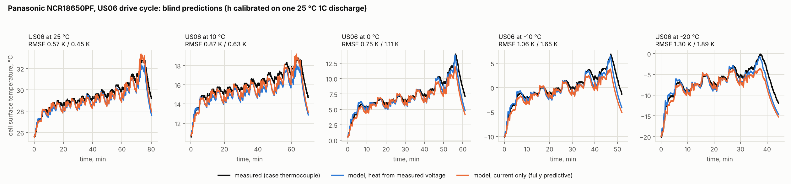
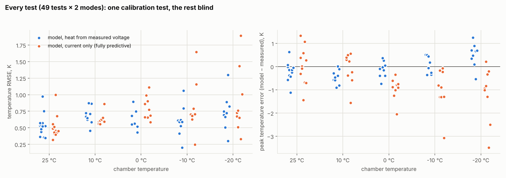
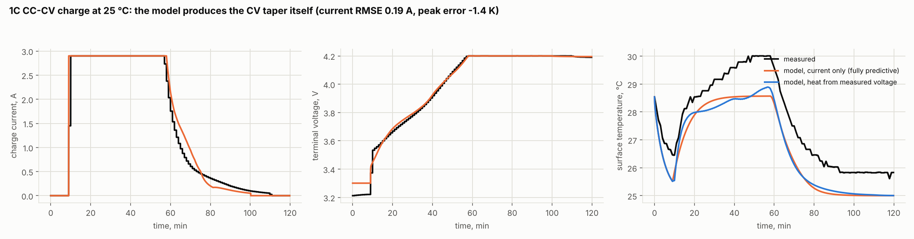

# Validation against measured cell temperatures

**Bottom line:**
- **Thermal model:** with one calibrated parameter, it predicts the measured surface temperature of a commercial 18650 cell within **0.59 K median RMSE** over 49 blind tests, from 25 °C down to −20 °C. That covers drive cycles, constant-current discharge and CC-CV charging.
- **Fully predictive model** (current in, voltage and temperature out): **0.65 K median RMSE** for temperature, with 88 % of tests within 1 K and every ambient's median at or below 0.77 K. Voltage error is **17–34 mV** from 25 °C to 0 °C and 53–70 mV at −10 and −20 °C (v0.4.10; it was 84–177 mV).

## Data

- **Dataset:** P. Kollmeyer, *Panasonic 18650PF Li-ion Battery Data*, Mendeley Data v1 (2018), doi:10.17632/wykht8y7tg.1, **CC BY 4.0**. A new 2.9 Ah Panasonic NCR18650PF (NCA/graphite) was tested in a thermal chamber at 25, 10, 0, −10 and −20 °C, with a thermocouple on the case at mid-height.
- **Same cell as the thesis:** the NCR18650PF is the cell the original MSc thesis calibrated its 3C heat load against.
- **Processed subset:** 49 tests are stored in `validation/data/panasonic_18650pf/` (3.3 MB, attribution in its README), made by `validation/prepare_panasonic.py`:
  - all 41 single drive cycles (US06, HWFET, UDDS, LA92, NN, mixed cycles 1–4);
  - two 1C discharges;
  - one 1C CC-CV charge.

## Method

| Step | Uses | Gives |
|---|---|---|
| OCV | 25 °C C/20 discharge (+ its I·R) | `src/packtherm/data/ncr18650pf_ocv.csv` |
| Kinetics | every HPPC pulse at all 5 temperatures (`validation/identify_panasonic.py`) | R0, Butler–Volmer charge transfer I₀(T) with Eₐ = 45 kJ/mol, low-SOC factor. 10 s overpotential within a median 5–11 % at every temperature |
| Cold laws (v0.4.10) | the 0.9 A discharge-and-rest steps between HPPC pulse sets at 25, 10, 0, −10 °C (`cold_laws`; the −20 °C file is incomplete) | low-SOC rise Eₐ = 20.7 kJ/mol; slow branch Eₐ = 26.8 kJ/mol (re-running the script gives 20.6 and 27.1) |
| Thermal calibration | **one test**: 25 °C 1C discharge #1, temperature | chamber h = 38.7 W/m²K |
| Slow polarisation | the same test, voltage | R_d = 28.4 mΩ, τ_d = 405 s |
| **Validation** | the other **48 tests, blind** | below |

Two modes are reported for every test:
- **Thermal:** heat = I·(OCV − V_measured). Only the thermal model is under test.
- **Predictive:** only the current goes in. The equivalent-circuit model predicts voltage and heat; temperature feeds back into resistance every step. For the CC-CV charge, only the charge *request* (1C) goes in, so the model has to produce the CV taper itself.

Other details:
- Records that begin with a long soak (cooling down after a charge) are trimmed to start 60 s before the current.
- Starting SOC comes from the rested voltage.
- The ambient is taken from the chamber channel only where it agrees with the setpoint; the channel reads a constant 0.0 in the −10 °C files.

## Results

| Ambient | Tests | Thermal mode: median RMSE / worst peak error | Predictive: median RMSE / worst peak error | Predictive voltage RMSE (median, before end-of-discharge knee) |
|---|---|---|---|---|
| 25 °C | 12 | 0.53 K / 1.1 K | 0.45 K / 1.4 K | 17 mV |
| 10 °C | 9 | 0.67 K / 0.9 K | 0.60 K / 1.6 K | 22 mV |
| 0 °C | 9 | 0.56 K / 0.7 K | 0.77 K / 2.0 K | 34 mV |
| −10 °C | 9 | 0.59 K / 0.5 K | 0.70 K / 3.1 K | 53 mV |
| −20 °C | 9 | 0.72 K / 1.2 K | 0.73 K / 3.5 K | 70 mV |

v0.4.10 compared with v0.4.9 (same 48 blind tests): predictive tests within 1 K 79 % → 88 %; −20 °C median 1.28 → 0.73 K; cold voltage error roughly halved. The worst cold peak errors changed sign: the model used to over-predict heat in the cold (+3.4 K worst, the safe side for design) and now under-predicts it slightly (−3.5 K worst, cold heat 7–10 % low on average).

The measured rises go up to 20 K in the cold. 96 % of thermal-mode tests and 88 % of predictive tests are within 1 K RMSE. Full per-test table: [`validation/summary.csv`](validation/summary.csv).





## What the validation does and doesn't show

- **Shown:**
  - The radial conduction and energy balance, and the jelly-roll heat capacity estimated from O'Regan 2022 layer data, reproduce a real cell's transient response across a 45 K range of ambient temperatures and 0–7C dynamic loads.
  - The electrical model reproduces voltage and self-heating from 25 °C down to 0 °C.
  - The CC-CV logic tracks the measured current taper.
- **Calibrated, not predicted:** h is a property of *this chamber*, not of the cell. In a design study h is the design variable, so calibrating it here is appropriate.
- **Known gaps:**
  - **Deep cold (v0.4.10):** the low-SOC rise now grows in the cold, so the voltage knee arrives earlier (the cold capacity loss), and the slow branch follows its own Arrhenius law. Both laws come from identification data, not the validation tests. In the cold the predictive model now under-predicts heat by 7–10 % on average (worst peak −3.5 K at −20 °C): a slow-branch law fitted at 0.3C is a little too gentle for drive-cycle currents. Following the charge-transfer kinetics instead over-predicts by a similar amount, so the true behaviour sits between the two.
  - **Cold capacity loss** is now modelled through that low-SOC rise; voltage error is still reported before the knee for comparability.
  - **Entropic heat** is still neglected for this NCA cell (no dU/dT data in the dataset). The charge is about 1.1–1.4 K under-predicted in both modes, consistent with missing reversible heat. Published NCA/graphite profiles disagree on the sign over the relevant SOC range (one study reports entropic heat strongly negative on charge, which would make the error worse), so no literature curve is applied; a potentiometric measurement on this cell would settle it.
  - **Single cell, thermocouple on the surface:** core temperature is not validated directly. The model's in-cell gradient is up to about 2.8 K at 2C (25 °C). Core-temperature datasets for the LG M50 (Warwick, Mendeley bf6fksxpp2) would close this gap, but they are not reachable from this build environment.

## Reproduce

```bash
python validation/run_panasonic.py           # validation table + figures (≈30 s)
python validation/run_panasonic.py --recalibrate
pytest tests/test_validation.py              # regression gates on these claims
# from the raw dataset (not stored here):
python validation/prepare_panasonic.py  /path/to/Panasonic-18650PF-Data
python validation/identify_panasonic.py /path/to/Panasonic-18650PF-Data
```
